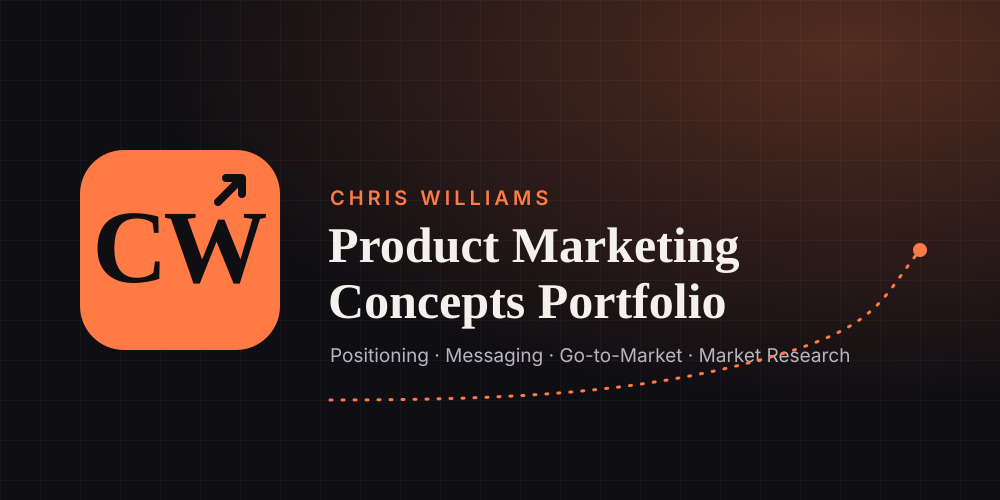
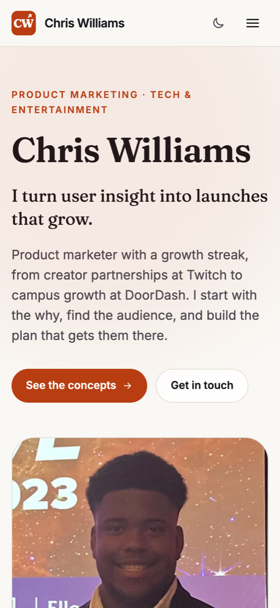
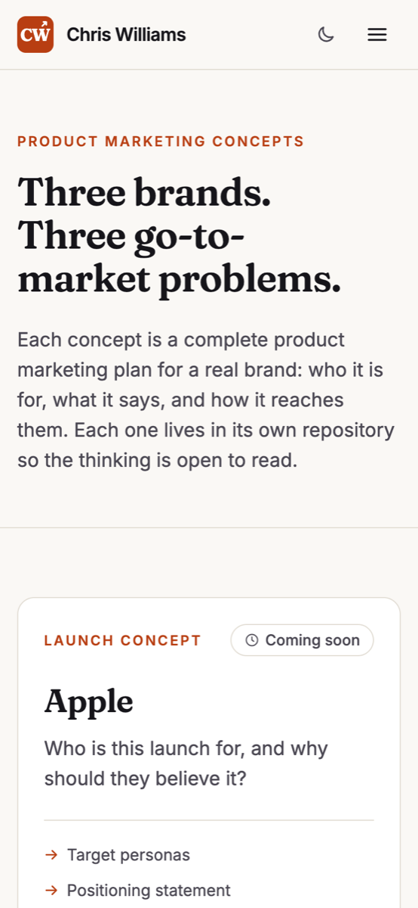
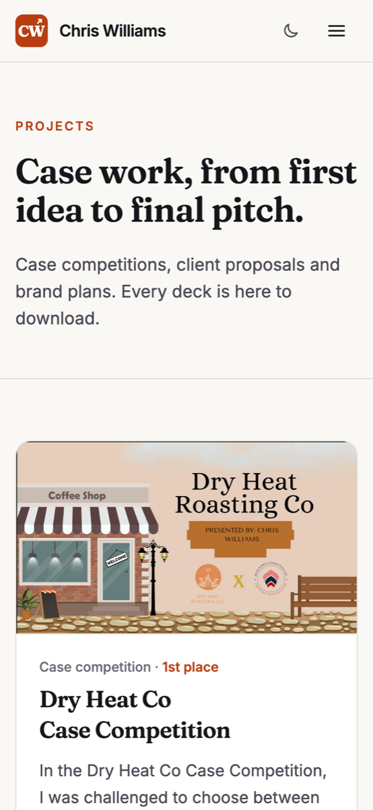

# Product Marketing Concepts Portfolio 📈

<kbd>
    
</kbd>

## Project Description 🎨

The personal portfolio of Chris Williams, a product marketer focused on tech and entertainment. It tells his story, shows his work at Twitch, Zenith (Publicis Media), Augment.us and DoorDash, collects his case-competition projects with downloadable decks, and links to three product marketing concepts (Apple, Nike and Spotify), each in its own repository. The site is a static TypeScript and React app built with Vite and hosted on GitHub Pages, with no server, no tracking and no third-party scripts.

## Screenshots:

    <kbd></kbd>
    <kbd></kbd>
    <kbd></kbd>

## Technologies Used 💻

### Frameworks
- [x] **React 19** — component UI and routing shell
- [x] **TypeScript 6** — strict types for every piece of content
- [x] **Vite 8** — dev server and static build
- [x] **Tailwind CSS 4** — styling driven by tested design tokens
- [x] **React Router 8** — one route per page
- [x] **Motion** — transitions that respect reduced motion

### APIs & Web Services
- [x] **GitHub Pages** — free static hosting
- [x] **GitHub Actions** — build, test and deploy on every push to `main`

### Data Sources
- [x] **src/content** — typed modules holding all copy, projects, concepts and awards
- [x] **public/files** — case-competition decks and reports

## Architecture 🏗️

- **Pattern**: content modules → page components → shared primitives
- **State Management**: local React state only; theme choice in `localStorage`
- **Navigation**: React Router, with every route pre-rendered as its own `index.html` so deep links work on GitHub Pages
- **Styling**: CSS custom properties generated from one palette file, consumed by Tailwind
- **Target**: evergreen browsers, Node 22+, TypeScript strict

## Features 🌟

- 🎯 **Hero & proof strip** — the claim and the numbers on the first screen
- 🧩 **Concepts hub** — Apple, Nike and Spotify go-to-market concepts
- 📂 **Case work library** — six projects with downloadable decks
- 🧭 **My Story & Persona** — background, core values and working style
- 🏆 **Awards & experience** — timeline and recognitions
- ✉️ **Contact** — compose an email without any data leaving your browser
- 🌗 **Light, dark & high-contrast themes** — all tested to WCAG AA

## Contributing ⚙️

Spotted a typo or a broken link? Fork the repository, create a branch, run `npm install` and `npm test`, and open a pull request describing the change.

## License 🪪

Code is released under the [MIT License](./LICENSE). Written content, images and documents © Chris Williams; please ask before reusing them.

